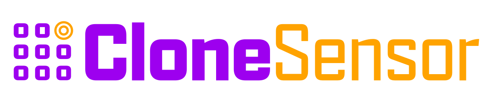
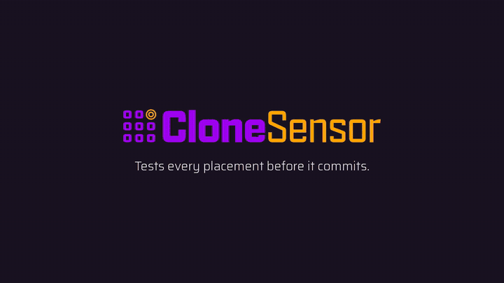

  

<strong>Every clone is tested before it's placed.</strong> 
No movement. No jitter. No overlaps.

  <a href="https://github.com/scowbeck/jackass-meshworks/releases/latest"><strong>Download the free beta</strong></a> ·
  <a href="docs/CloneSensor-User-Guide.pdf">User guide (PDF)</a> ·
  <a href="https://github.com/scowbeck/jackass-meshworks/issues/new/choose">Report a bug</a> ·
  <a href="https://www.jackassmeshworks.com/clonesensor">Website</a>

  

---

CloneSensor is a predictive placement plugin for **Cinema 4D**. It places clones on a surface so they never occupy the same space.

Most scatter tools place everything first and push the overlaps apart afterward, which moves clones you already liked and still leaves some intersecting. CloneSensor works the other way around. Each candidate is tested before it is kept:

1. **Candidate.** A point is proposed on the surface from the sampling mode and the seed.
2. **Keep away.** Edges, splines and fields can refuse the point before any clone is made.
3. **Occupancy.** The clone's shape is tested against space already reserved.
4. **Reserve.** A fit is kept. An overlap is thrown away. Nothing is pushed apart afterward.

The same seed, Max Count, settings and surface always produce the same clones. The frame number is not an input, so layouts don't shimmer when you scrub.

> **This is a free beta (version 1.0.0).** It's ready for real scenes, and your feedback shapes version one. Please [report anything odd](https://github.com/scowbeck/jackass-meshworks/issues/new/choose).

## Features

| | |
|---|---|
| **Tested placement** | Each clone's shape is checked against space already reserved. A fit is kept, an overlap is discarded. |
| **Repeatable results** | Same seed, same settings, same surface, same clones. Every time. |
| **Seven sampling modes** | Random, Poisson Disk, Blue Noise, Grid, Hex Packing, Vertex and Polygon Center. |
| **Layout presets** | Crowd, Seating, Festival, Parking and Booths, in real-world sizes converted to your project units. |
| **Collision shapes** | Sphere, Bounding Box or Footprint, tested in 3D or along the surface, sized per asset or from a shared radius. |
| **Keep away** | Edge margins, splines and Cinema 4D fields refuse points before a clone is made. |
| **Fill Surface** | One click fills the whole surface. Spread Across Surface reaches separate floors and mesh islands. |
| **Rules engine** | Categories, weights, priorities and clearance between groups, such as `seating:seating=90cm`. |
| **Flexible output** | Instances, Render Instances, Multi-Instance, Point Cloud or a ready-made Cloner. |
| **Debug overlays** | Occupancy circles, collision cells, accepted and rejected points, and full solve statistics. |

## Requirements

- **Cinema 4D 2026 or 2027** (this build was tested in 2027)
- **Windows** (macOS hasn't been tested yet; reports welcome)
- No other plugins or libraries needed.

## Install

1. Download the latest zip from **[Releases](https://github.com/scowbeck/jackass-meshworks/releases/latest)** (under **Assets**, pick `CloneSensor-v1.0.0-beta.zip`, not the source code links).
2. Unzip it. You'll get a folder named **CloneSensor**.
3. Put that folder in your Cinema 4D plugins folder. The easiest way to find it: in Cinema 4D, choose **Edit → Preferences**, click **Open Preferences Folder** at the bottom, and open the **plugins** folder there (create it if it doesn't exist).
   You can also keep the folder anywhere and add its location under **Edit → Preferences → Plugins**.
4. **Quit Cinema 4D completely** and start it again.
5. CloneSensor is now under **Extensions → CloneSensor**.

**Updating:** delete the old CloneSensor folder, copy in the new one, then quit and restart Cinema 4D. If you ever see two CloneSensor entries in the Extensions menu, a full restart fixes it.

## Quick start

1. Add **CloneSensor** from the Extensions menu.
2. Drag your ground, wall or mesh into **Surface**.
3. Parent the objects you want to scatter under CloneSensor. Each child is a source: a chair, a tree, a tent, a car.
4. Look at the preview, then press **Fill Surface** when you want the whole surface.

A new CloneSensor starts as a quick preview: Polygon Center sampling, Max Count 50, Bounding Box collision, Per Asset Size and Sit on Surface. The status under Max Count reads *Ready*, then *Complete* with the solve time. Fill Surface writes 0 into Max Count and fills up to **Fill Safety**, which starts at 20,000.

The [user guide](docs/CloneSensor-User-Guide.pdf) covers every control, the layout presets, rules, project units and four recipes you can copy (crowds on a plaza, chairs that must not intersect, tents with seating rules, and parking along an aisle).

## Good to know

- **Collision only checks clones from the same CloneSensor.** It doesn't test scene geometry or other CloneSensor generators. Use Keep Away margins, splines or fields to keep clones off buildings and paths.
- **A small Max Count may cover only part of the surface.** Clones grow outward from the seed's first point. Press Fill Surface (or type 0) to keep going until nothing else fits.
- **Sizes feel 100× off?** Check **Project Settings → Project Scale**. Presets and the starting radius are real centimeters converted into that scale.
- **Sources disappear from the viewport while the generator is on.** That's expected: the clones are copies. Turn the generator's checkmark off to see and edit the originals.

### Known limitations in 1.0.0

- A scene saved before a setting existed picks up the new default for it when opened. A duplicated generator keeps its source values rather than new-object defaults.
- Setting Radius or Size from a script before the generator's first execute can be replaced by the converted defaults. Set custom lengths after that first execute.
- With Relaxation above 0 and a Position offset, the offset is applied again when a clone slides. Relaxation is off (0) by default.

## Feedback and bugs

This is where the beta gets better. Please use **[Issues](https://github.com/scowbeck/jackass-meshworks/issues/new/choose)** to:

- **Report a bug.** The form asks for your Cinema 4D version, operating system and the steps to reproduce it. A small scene file helps a lot.
- **Suggest a feature** or a workflow CloneSensor should handle.

Prefer email? Write to **support@jackassmeshworks.com**. Jackass Meshworks is a small workshop, so every note goes straight to the creator.

## License

CloneSensor is free to use during the beta, in personal and commercial projects. It may not be resold, redistributed or reverse engineered. See [LICENSE.md](LICENSE.md) for the full terms.

---

Made by <a href="https://www.jackassmeshworks.com">Jackass Meshworks</a> · Forensic-grade workflow tools for 3D artists.

